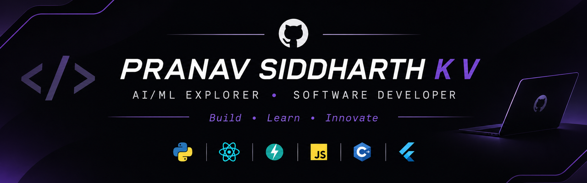

  

## 👨‍💻 About Me

Hey! I'm **Pranav Siddharth K V** 👋

🎓 Software Systems Student  
🤖 Aspiring AI/ML Engineer  
💻 Interested in Artificial Intelligence, Machine Learning & Software Development.

- 🌱 Currently learning **Machine Learning and AI**
- 🔭 Building practical projects using **Python, React and FastAPI**
- 🧠 Exploring **LLMs, RAG, Vector Databases and AI applications**
- 🚀 Passionate about turning ideas into real-world projects.

> *Learning by building. Growing through experimentation.*

## 🛠️ Tech Stack

### Languages

### Frameworks & Development

### AI / ML & Tools

## 🚀 Featured Projects

### 1. PDF Chatbot — RAG Application

An AI-powered PDF chatbot that allows users to upload documents and ask questions using Retrieval-Augmented Generation.

**Tech Stack:** React, Vite, FastAPI, Python, Hugging Face, ChromaDB, Sentence Transformers.

**Key Features:**
- 📄 PDF document upload and processing
- 🧩 Intelligent text chunking and embeddings
- 🔍 Semantic search using vector databases
- 🤖 AI-powered question answering
- 📚 Context-based responses with citations

**Live Demo:** [Try PDF Chatbot](https://pdf-chat-bot-tawny.vercel.app/)
## 📊 GitHub Contributions

  

## 🐍 Contribution Activity

  

